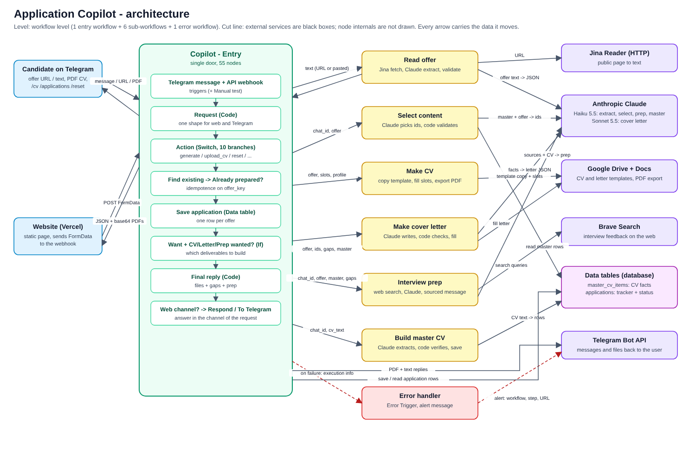

# Application Copilot

**The need, in one sentence:** a student who applies to many finance and tech internships rewrites a CV and a cover letter by hand for every offer, prepares interviews from scattered web pages, and tracks applications in their head or a spreadsheet.

Application Copilot takes a job offer (a link, pasted text, from Telegram or from a small website) and returns a **one-page CV** and a **cover letter** (Google Docs exported as PDF) tailored to that offer, plus an **interview prep sheet** with numbered web sources. It also keeps a tracker of applications with a status. It never sends an application: the user does.

Principle: **the model proposes, code verifies.** Claude only picks ids from the user's own master CV and writes JSON; Code nodes check that ids exist, that numbers, dates, verbs and tools appear in the master CV or the offer, that the CV fits one page, and that gaps are never claimed. If a check fails, the user gets a clear message instead of an invented fact.



Level: workflow level (one entry workflow, six sub-workflows, one error workflow). Cut line: external services are black boxes and node internals are not drawn. Source: `docs/architecture.svg`.

## Workflows

| File | Role |
|---|---|
| `workflows/Copilot - Entry.json` | Single door: Telegram trigger, webhook for the website, manual test trigger, `Action` Switch (generate, upload_cv, reset, applications, set_status, profile, clear_applications, usage, denied), idempotence check, replies |
| `workflows/Copilot - Read offer.json` | Link or text to a validated offer (Jina Reader, Claude Haiku, validation) |
| `workflows/Copilot - Select content.json` | Claude picks ids from the master CV, Code validates them, builds the CV slots and the gaps |
| `workflows/Copilot - Make CV.json` | Copies the Google Docs template, fills it, exports the PDF |
| `workflows/Copilot - Make cover letter.json` | Claude Sonnet writes, Code checks the letter, fills the template, exports the PDF |
| `workflows/Copilot - Interview prep.json` | Brave Search, Claude Haiku, sourced Telegram message |
| `workflows/Copilot - Build master CV.json` | Turns an uploaded CV into verified rows of the master CV table |
| `workflows/Copilot - Error handler.json` | Error Trigger: sends an alert with workflow name, step, error and execution URL |

## Run it yourself (Docker)

Requirements: Docker with Compose v2.

```bash
git clone <this repository>
cd application-copilot
cp .env.example .env          # then edit .env (see below)
docker compose up -d
docker compose ps             # postgres and n8n should become "healthy"
```

Open <http://localhost:5678>, create the owner account, and the eight workflows are already imported (unpublished). The compose file starts n8n **2.44.6** and Postgres **16.4**, with named volumes (`postgres_data`, `n8n_data`): `docker compose down` then `up` keeps workflows, credentials and data.

### Environment variables

| Variable | Meaning |
|---|---|
| `POSTGRES_USER`, `POSTGRES_PASSWORD`, `POSTGRES_DB` | n8n database |
| `N8N_ENCRYPTION_KEY` | Encrypts stored credentials. Generate with `openssl rand -hex 32` and keep it |
| `N8N_HOST`, `N8N_PROTOCOL`, `WEBHOOK_URL` | Public address of n8n. A Telegram trigger needs a public https `WEBHOOK_URL` (cloudflared or ngrok tunnel to `localhost:5678`) |
| `N8N_SECURE_COOKIE` | `false` for plain http on localhost |
| `GENERIC_TIMEZONE` | Time zone for dates (default `Europe/Paris`) |

Real secrets live only in `.env`, which Git ignores. Only `.env.example` is committed.

### Credentials to create in n8n (never committed)

| Credential | Used by |
|---|---|
| Telegram API (bot token from @BotFather) | Telegram trigger, sends, error alerts |
| Google Drive OAuth2 and Google Docs OAuth2 | `Make CV`, `Make cover letter` (copy template, fill, export PDF) |
| Anthropic API key | the Claude chat model nodes |
| Brave Search API key | `Interview prep` |

Two data tables are also needed (columns are visible in the nodes that use them): `master_cv_items` and `applications`. Two Google Docs templates (CV and letter) hold the placeholders such as `{{summary}}`, `{{exp1_org}}`, `{{p1}}`.

## How to test

1. **Manual trigger.** In `Copilot - Entry`, click *Execute workflow* from the `Manual test` node. It sends a saved test payload (the same shape the website posts) through the whole pipeline. It sits next to the real `API` webhook and `Telegram message` triggers.
2. **Webhook.** Send what the website sends:
   ```bash
   curl -X POST "$WEBHOOK_URL/webhook/copilot-api" \
     -F action=generate -F token=<16-40 lowercase letters or digits> \
     -F access=<ACCESS_CODE> -F offer="https://example.com/job" -F want=cv,letter,prep
   ```
3. **Telegram.** Send a job link: the bot asks if you want the CV and the letter, then sends the PDFs and the interview prep. `/cv <text>` or a PDF updates your master CV, `/applications` lists applications, `/reset` clears the profile. Any other short text returns a usage message.

### Robustness checks you can run

| Check | What to do | Expected |
|---|---|---|
| Invalid input | Send `hello` on Telegram, or a wrong `action` to the webhook | Usage message / `denied` |
| Idempotence | Send the same offer twice | Second time: "Already prepared on ... Nothing new was created", no new row |
| Failure path | Send `https://example.invalid/job` | Clear message "I couldn't open that link...", execution stays green because the error is handled |
| AI output validation | Checks in `Validate selection`, `Validate letter`, `Validate offer` | Invalid ids are dropped, a fallback summary is used, an unreliable letter is refused with the reasons |
| Crash alert | An unexpected crash of `Copilot - Entry` (production run) triggers `Copilot - Error handler` | Telegram alert with workflow, step, message and execution URL |
| Retries | Every external call (HTTP, AI, database, Telegram, Google) has Retry On Fail with 3 tries and a wait | |

## Repository layout

```
docker-compose.yml        n8n + Postgres + one-shot workflow import
.env.example              variables to copy into .env
workflows/                exported workflows (JSON, no credentials)
docs/                     architecture diagram
scripts/export-workflows.sh   exports the running workflows back to ./workflows
```

## Notes

- The `access` field of the website is a shared access code that gates the public webhook; it is a simple demo gate, not an authentication system.
- Credentials are stored encrypted by n8n in the database; workflow JSON only references them by name.
